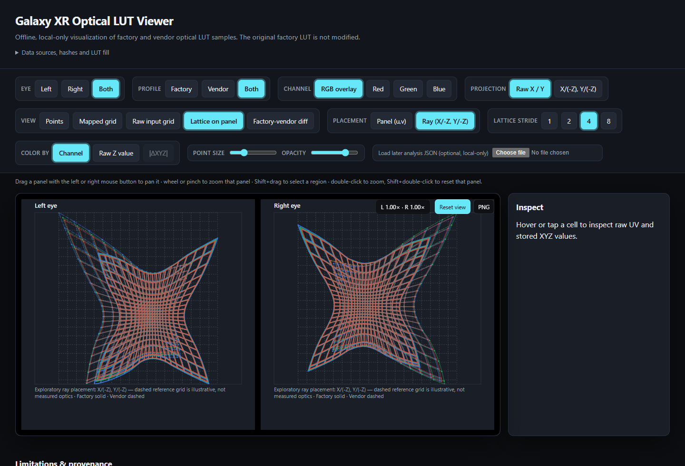

# GXR-Distortion-Profile

> **Peek inside the Galaxy XR optical fingerprint — no flashing, no myths, no modified firmware.**

This is a read-only playground for the headset’s factory display/lens calibration: extracted `display_profile_v2` subtrees, a parser/validator, an interactive viewer, and derived-metric tools. The viewer processes everything in your browser once the page loads; the hosted site serves only static files, with no tracking or telemetry. Local tools make no network calls and never modify the originals.



## Try it online

**Viewer (GitHub Pages):** https://angeldark92.github.io/GXR-Distortion-Profile/

**Direct downloads:**

- [Full parsed/validated LUT](https://angeldark92.github.io/GXR-Distortion-Profile/downloads/analysis.json) — `analysis.json`
- [Factory per-device profile subtree](https://angeldark92.github.io/GXR-Distortion-Profile/downloads/factory-display-profile-v2.textproto) — `factory-display-profile-v2.textproto`
- [Vendor average profile subtree](https://angeldark92.github.io/GXR-Distortion-Profile/downloads/vendor-display-profile-v2.textproto) — `vendor-display-profile-v2.textproto`
- [Provenance + checksums](https://angeldark92.github.io/GXR-Distortion-Profile/downloads/provenance.json) — `provenance.json`
- [SHA-256 sums](https://angeldark92.github.io/GXR-Distortion-Profile/downloads/SHA256SUMS) — `SHA256SUMS`

## What this is

The Galaxy XR stores per-eye optical calibration as `display_profile_v2` inside `device_profile.textproto`. The factory copy lives on the EFS partition; a vendor-average copy lives under `/vendor/etc/calibration_service`. Both containers also hold camera/IMU data, so this project keeps **only the `display_profile_v2` subtrees** — byte-preserved originals, not the whole `device_profile.textproto`, and definitely not a flashable payload.

Each eye carries a **79 × 73 sample lattice** across a **3552 × 3840** panel, with **per-channel R/G/B XYZ geometry** at every sample. The viewer lets you explore the factory per-device profile, the vendor average profile, and the differences between them.

## Factory vs. vendor average

- **Factory profile** — the calibration written for one specific headset at the factory.
- **Vendor profile** — an average calibration shipped in the system image for consumer devices.

The comparison is exploratory. It does not establish which source a running compositor loads, whether it reloads, or whether one profile produces “better” optics.

## Quick start (local)

Requires **Python 3** installed.

Double-click `Start-GXR-Viewer.bat`, or run it from the repo root:

```bat
Start-GXR-Viewer.bat
```

It builds `viewer\optics-viewer.html` from `data\analysis.json`, serves the `viewer` folder on `127.0.0.1` with `tools\serve_viewer.py`, and opens the page in your default browser. Closing the console window (or `Ctrl+C`) stops the server. If local serving does not work, use the `--direct` flag to open the built file straight from disk.

## Controls

Each eye has its own panel with independent zoom and pan, so you can compare the two eyes at different magnifications.

| Input | Action |
| --- | --- |
| Drag with left, middle, or right mouse button | Pan that panel, live while held |
| Mouse wheel, or two-finger pinch | Zoom that panel about the pointer or pinch midpoint |
| Double-click | Zoom that panel 2× about the pointer |
| Shift + double-click | Reset that panel only |
| Shift + drag | Select a rectangular region and export those samples as CSV |
| `+` / `-` / `0` with the plot focused | Zoom the panel under the pointer, or reset both panels |
| Arrow keys with a sample selected | Move to the neighbouring lattice sample |
| Escape | Clear the selection |
| Hover or tap a sample | Inspect raw UV, stored XYZ, and lattice placement |

The readout shows both panels’ zoom (`L 1.00x · R 1.57x`). Panning is limited so at least 40 px of plotted content stays visible.

## Rebuild from source

Run these from the repo root.

Build the standalone viewer HTML:

```bat
python -B build_viewer.py data\analysis.json -o viewer\optics-viewer.html
```

`build_viewer.py` produces only the viewer HTML; it does not bundle the downloads. For a complete viewer + downloads package, build the Pages site below.

Regenerate `data\analysis.json` from the retained captures:

```bat
python -B tools\analyse_optics.py ^
  --factory data\captures\optical-capture-verified\originals\mnt\vendor\efs\device_profile.textproto.display_profile_v2.textproto ^
  --vendor  data\captures\optical-capture-verified\originals\vendor\etc\calibration_service\device_profile.textproto.display_profile_v2.textproto ^
  --manifest data\captures\optical-capture-verified\capture_manifest.json ^
  --output data\analysis.json --expect-device
```

Export per-cell derived metrics:

```bat
python -B tools\derive_metrics.py --analysis data\analysis.json --out "metrics-output"
```

## Build the Pages site

Package the viewer plus downloadable artifacts for GitHub Pages:

```bat
python -B tools\build_pages.py --output _site
```

The Pages workflow runs checks, builds this package, and deploys `_site` when changes reach `main`. Only the viewer and five download files are published to the site.

## Tests

```bat
python -B -m unittest discover -s tools -p "test_*.py" -v
python -B tools\check_viewer_ui.py
```

`tools\check_viewer_ui.py` exercises the built viewer in real Chrome when Playwright is available; it exits cleanly with code 0 if Playwright is not installed.

## Provenance

Only the `display_profile_v2` subtrees are retained in this repository. The surrounding `device_profile.textproto` container — which mixes in camera and IMU calibration — was streamed read-only for hashing and was never written to this PC.

Capture transport used explicit base64 encoding because KernelSU’s root shell runs over a PTY that rewrites LF to CRLF. Round-trip integrity was checked with 256-byte probes and before/after source hashes. Detailed checksums and capture notes are published in the [provenance download](https://angeldark92.github.io/GXR-Distortion-Profile/downloads/provenance.json) and recorded in `data/captures/optical-capture-verified/capture_manifest.json`.

## Research boundaries

`tools\build_optics_module.py` builds an **original-only KernelSU userspace module**, not a kernel `.ko`. The resulting package reconstructs the stock file in its own root-private directory, refuses altered profiles, and is inert until an explicit token-gated `apply`.

A successful bind proves filesystem plumbing only. It does **not** prove which calibration the compositor loaded, that it reloaded, or that optics improved. Any altered-profile work would need a validated payload contract, a controlled consumer reload, and measured safety results.

This repository does not contain a rooting or flashing tutorial. Consumer binaries and private deployment records will not be published.

## License and data notice

The code and documentation in this repository are released under the **GNU General Public License v3** (see [`LICENSE`](LICENSE)). That license does not establish redistribution or modification rights for Samsung/supplier calibration data. The extracted subtrees are provided for independent research and reproducibility; no ownership claim over headset firmware or calibration is made.

## Honest caveats

- XYZ units and coordinate-frame origin are **not established**. Ratio-derived values are exploratory geometry, not measured degrees of lens distortion.
- There are **no through-lens photographs** in the dataset.
- No **optical-improvement** claim is made.
- Retained files are **original `display_profile_v2` subtrees**, not the whole `device_profile.textproto`, and not flashable firmware.
